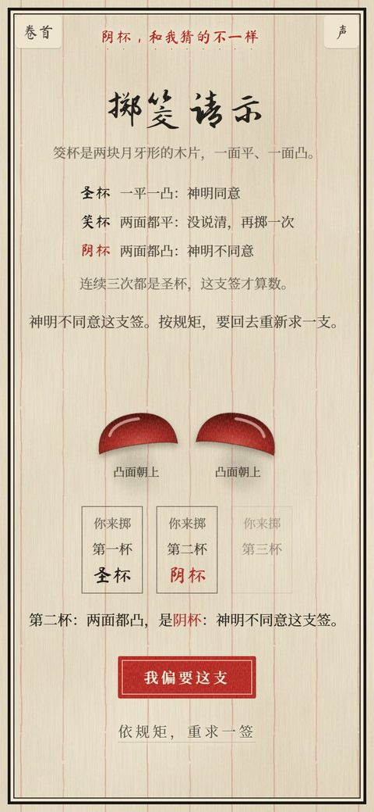
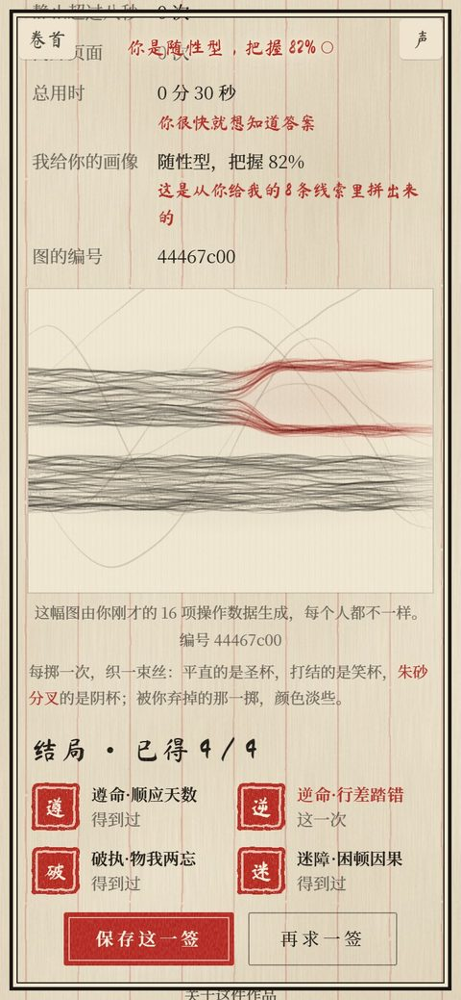

# 演算天机

**你求签，我算你。**

《演算天机》是一部收录多种民间算命法的书，一卷一卷地开。目前开了第一卷"签"：一场被算法旁观的求签仪式——摇签、掷筊请示、解签。这本书就是那位"大师"：他的话是字迹，从书页的空白处一笔一笔洇出来，说完渗进纸里、淡去（朱笔只用来圈点），记下你的每一次犹豫和重掷，猜你会不会失望。摇签、掷筊用的器物摆在书外的桌面上，书只记下结果。直到结局他才点破：在你求签的时候，他也在给你算命。

单局约两分钟，有四种结局，桌面为主，手机也能完整玩。整个作品是一册摊开的古书，每走一步翻一页：左页是大师的页，术语出现时页边同步作注，讲它是什么、从哪里来。在线体验：https://suantianji.pages.dev

<p align="center">
  
  
  
</p>

## 玩法

0. 卷首目录里点"签"卷入卷（卦、卜、鸟、字、历几卷尚未开卷）。
1. 按朱印"问"开始，选想问的方向（功名 / 尘缘 / 身心），可以写下具体的问题。
2. 摇签：手机直接晃，电脑按住签筒左右拖。
3. 掷筊请示：一平一凸是圣杯，两平是笑杯（再掷），两凸是阴杯（神明不同意）。连得三个圣杯，这支签才算数。
4. 观象：解签、结局、大师的坦白、行为账本，以及用你这一局的操作数据织成的命盘。

四种结局不看签的好坏，只看你怎么对待被给出的答案。可以试试：

- 留意书页空白处渐渐洇出来的字迹，它从你打开页面起就在记录。
- 掷出阴杯时，偏要这支签。
- 一次次重求，直到求到第三支签。
- 犹豫的时候，看看画面左下角。

## 特点

- **零位图**：画面全部由 SVG、CSS 和 Canvas 绘制，声音全部由 Web Audio 实时合成。
- **Astro + Svelte，纯静态**：Astro 管路由、静态页与 Markdown 讲解，仪式部分是 Svelte 组件；构建后是纯静态站（`dist/`），`functions/` 照常给 Cloudflare Pages 用。没有 UI 组件库，没有 CSS 框架。
- **公共层 + 卷**：书（古籍版式、翻页、书的话与动作）、案、印章、墨与水、声音、摇动控制、观人术、命盘、四态结局、分享图、通灵、注疏都在 `src/core/`；每一卷只写自己的器物、数据和规矩（`src/juan/<id>/`），在 `src/juan/index.js` 注册。
- **按真实习俗**：六十甲子签依甲子至癸亥排列，五行取纳音；掷筊规矩依闽台庙宇。
- **按真实物理**：签筒的倾角、竹签的弹跳、落签都由物理模拟驱动，手机上用加速度计。
- **隐私**：操作记录只存在你自己的设备上。只有勾选"通灵模式"时，你写下的问题才会发给云端 AI，且不保存。

## 本地运行

需要 Node 22.12 以上（`package.json` 的 `engines`）：

```bash
npm install
npm run dev        # http://localhost:8788
npm run build      # 构建到 dist/
npm run preview    # 预览构建结果
```

开发服务器不带 Functions，通灵模式不可用（页面照常显示离线判词）。连同通灵模式（Workers AI）一起调试：

```bash
npm run build && npx wrangler pages dev dist --ai AI
```

本地调用 Workers AI 也会走你的 Cloudflare 账户。

## 部署自己的一份

1. 建 D1 数据库并建表（通灵模式的按天限流计数）：

   ```bash
   npx wrangler d1 create suantianji
   npx wrangler d1 execute suantianji --remote --file migrations/0001_hits.sql
   ```

2. 把 `wrangler.toml` 里的 `database_id` 换成上一步输出的值。
3. 部署：

   ```bash
   npm run build
   npx wrangler pages deploy dist --project-name <你的项目名> --branch main
   ```

不建数据库、不配 AI binding 也能玩，只是通灵模式不可用，结局页照常显示离线判词。限流阈值在 `functions/api/oracle.js` 顶部（默认每个 IP 每天 10 次、全站 200 次）。

## 目录

| 路径 | 内容 |
|---|---|
| `src/pages/` | 路由：`index.astro` 卷首目录、`qian/index.astro` 签卷仪式、`qian/yuanliu.md` 签卷源流、`about.astro`、`404.astro` |
| `src/core/` | 公共层：`Paper.astro` 页面外壳（ClientRouter，书常驻）、`Codex.svelte` 常驻的书（天头栏 + 书 + 案 + 页脚）、`BookFrame.astro` / `PageData.astro` 静态页交给书的内容、`Ritual.svelte` 一卷的运行、`Spread.svelte` 每一屏的对页登记、`book/` 翻页（点页、拖页角、写下的页、书的动作）、`gloss.js` 书的话、`Seal.svelte` 印章、`ink.js` 墨与水、`audio.js` 声音、`shake.svelte.js` 摇动控制、`profile.js` 观人术、`loom.js` 命盘、`poster.js` 分享图、`oracle.svelte.js` 通灵、`Zhu.svelte` / `ZhuPanel.svelte` 注疏、`end/` 结局各部分、`styles/` 样式 |
| `src/juan/index.js` | 卷的注册表与卷的接口说明（六卷的元数据，后五卷 `open: false`） |
| `src/juan/qian/` | 签卷：`game.svelte.js` 一局的流程与结局映射、各屏的 Svelte 组件、`tube.js` 签筒物理、`jiao.js` 掷筊、`zhu.json` 注、`fortune-db.json` 六十一支签与四种结局判词 |
| `public/` | 原样发布的静态资源：`fonts/` 按站内用字裁出的字体子集，`img/title-ink.svg` 标题墨痕 |
| `functions/api/oracle.js` | 通灵模式的 Pages Function |
| `tools/subset-fonts.py` | 重新裁字体子集（改了中文文案后要跑，依赖见 `requirements.txt`） |
| `tools/check-db.mjs` | 校验签簿：七言四句、六十甲子顺序、五行与吉凶配平（CI 也跑） |
| `docs/DESIGN.md` | 设计规范 |

## 许可

- 程序代码：[MIT](LICENSE)
- 文案（签诗、解签、判词、眉批与界面文字、通灵提示词）：[CC BY-NC-SA 4.0](LICENSE-CONTENT)，可以改编、转载，但须署名、不得商用，改编后以相同许可发布
- 字体：霞鹜文楷与思源宋体是 SIL Open Font License 1.1，见 [public/fonts/OFL.txt](public/fonts/OFL.txt)

## 致谢

- 字体：[霞鹜文楷](https://github.com/lxgw/LxgwWenKai)、[思源宋体](https://github.com/notofonts/noto-cjk)，标题用汇文明朝体。
- 设计原则部分借鉴 [InkView](https://github.com/qybaihe/inkview)（MIT）。
